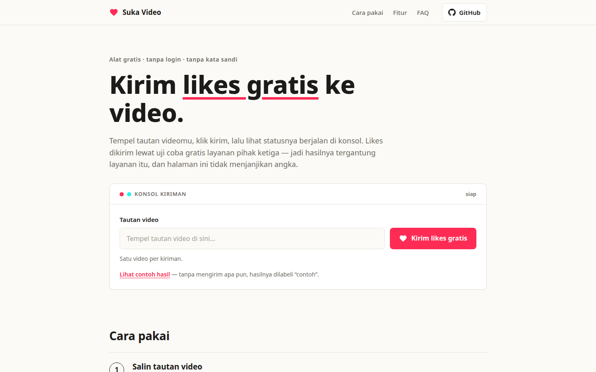
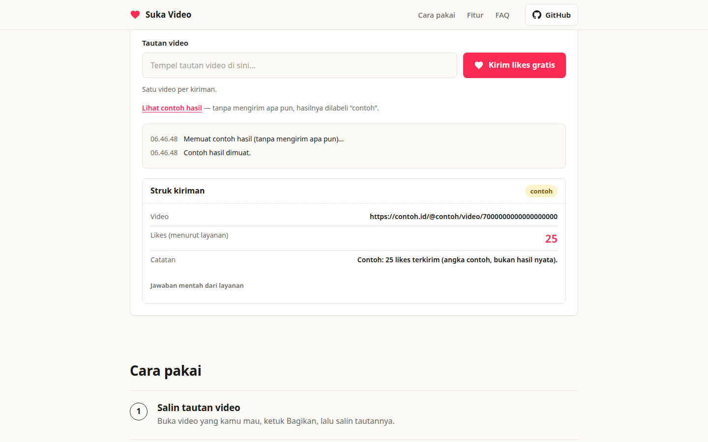
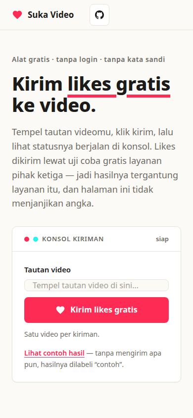

# Suka Video

Tempel tautan video, kirim likes gratis — tanpa login, tanpa kata
sandi. Likes dikirim lewat uji coba gratis
[leofame.com](https://leofame.com/free-tiktok-likes), jadi jumlahnya
mengikuti kuota layanan itu dan halaman ini tidak menjanjikan angka.

**Live:** https://sukavideo.pages.dev

> **Catatan rebrand 20 Nov 2026:** nama lama "TikTok Likes Tool" diganti
> "Suka Video" dan penyajian dibuat generik. Fungsi tidak berubah: saat ini
> hanya tautan video TikTok yang diterima, karena upstream
> (leofame.com/free-tiktok-likes) hanya melayani itu — allowlist host +
> endpoint upstream dipertahankan apa adanya di sisi server.



## Cara pakai

1. Buka video yang kamu mau, ketuk **Bagikan**, salin tautannya.
2. Tempel tautan di konsol kiriman di halaman live.
3. Klik **Kirim likes gratis** dan ikuti log statusnya sampai struk
   kiriman muncul.

Tombol **Lihat contoh hasil** menampilkan struk contoh (berlabel
"contoh") tanpa mengirim apa pun.





## Video demo

[docs/demo/demo.mp4](docs/demo/demo.mp4) — rangkaian screenshot: landing,
struk contoh, dan tampilan mobile.

## Cara kerja

```
browser ──► Cloudflare Pages Worker (_worker.js)
              ├─ POST /api/likes {"url"}  → validasi host TikTok
              │     → GET leofame.com/free-tiktok-likes (ambil token + cookies)
              │     → POST leofame.com/free-tiktok-likes?api=1 (kirim tautan)
              │     → jawaban upstream diteruskan apa adanya
              ├─ POST /api/tiktok (alias endpoint lama)
              ├─ GET  /api/status
              └─ GET  /api/demo (hasil contoh, demo:true)
```

Detail lengkap: [docs/ARCHITECTURE.md](docs/ARCHITECTURE.md),
[docs/diagrams.html](docs/diagrams.html).

## Menjalankan lokal

```bash
npm ci
npm test            # unit test worker
npm run validate    # tautan + gate anti-slop P0 + secret
npm run build       # hasil ke dist/
npm run serve       # server lokal di http://127.0.0.1:8331
npm run smoke       # verifikasi dist/ (persis yang di-deploy)
npx playwright test # e2e desktop + mobile
```

Prasyarat: Node.js ≥ 22. Tanpa dependensi produksi — worker memakai
`fetch` bawaan Cloudflare Workers.

## Struktur proyek

```
public/                 # situs statis (index.html, app.js, style.css, favicon.svg)
worker/                 # _worker.js (Pages Worker) + _worker.test.mjs
scripts/                # build, serve-worker, smoke, check-*, advisory-sweep, screenshot, make-video
e2e/                    # Playwright e2e
docs/                   # DESIGN.md, ARCHITECTURE.md, deploy.md, testing.md, diagrams.html, demo, screenshots
.github/workflows/     # CI (build, worker-test, static-checks, advisory-sweep, e2e, smoke)
```

Desain mengikuti kontrak di [docs/DESIGN.md](docs/DESIGN.md): referensi
pemenang **Plumb Proof** (Framer), palet Kertas/Tinta/Merah Hati, font
Bricolage Grotesque + Public Sans, detail khas konsol kiriman dengan log
status berjalan.

## Kejujuran soal likes

- Alat ini **bukan** penyedia likes. Likes berasal dari uji coba gratis
  leofame.com; jumlahnya ditentukan layanan itu dan bisa berubah atau habis.
- Kalau upstream berubah, sibuk, atau menolak, worker menjawab 502 dengan
  pesan jujur — bukan angka palsu.
- Jangan pernah memberikan kata sandi akunmu ke alat apa pun, termasuk
  yang ini (alat ini tidak pernah memintanya).

## Lisensi

MIT — lihat [LICENSE](./LICENSE).

---
_Dikembangkan oleh **dezzorigin** (Nabil Aulia Dika)._
